# Karang Taruna Digital

**Karang Taruna Digital** adalah aplikasi mobile berbasis **Flutter dan Firebase** yang dirancang untuk membantu organisasi Karang Taruna mengelola keuangan, inventaris, peminjaman barang, dan data anggota secara digital, terstruktur, serta transparan.

Aplikasi ini dikembangkan untuk menggantikan proses administrasi manual yang sering kali menggunakan buku catatan atau spreadsheet terpisah. Dengan sistem terpusat dan pembagian hak akses berdasarkan peran pengguna, pengelolaan organisasi menjadi lebih praktis, efisien, dan mudah dipantau.

## 📱 Kompatibilitas Perangkat

> [!IMPORTANT]
> **Kompatibilitas Android:** aplikasi ini ditujukan **hanya untuk Android versi 7 hingga Android 17**. Perangkat di luar rentang versi tersebut tidak termasuk dukungan yang dinyatakan. Rentang ini adalah ketentuan dukungan proyek; pengujian perangkat nyata/emulator pada setiap versi tetap perlu dilakukan untuk memastikan kompatibilitas.

## 🎯 Tujuan Aplikasi

Karang Taruna Digital bertujuan untuk:

- Mempermudah pencatatan pemasukan dan pengeluaran kas organisasi.

- Meningkatkan transparansi keuangan kepada seluruh anggota.

- Menggabungkan informasi saldo dari beberapa Bendahara yang saling terhubung.

- Membantu pengelolaan data inventaris dan ketersediaan barang.

- Mencatat aktivitas peminjaman dan pengembalian inventaris.

- Mempermudah pengelolaan akun serta hak akses pengguna.

- Menyediakan informasi dan laporan organisasi secara terpusat.

## ✨ Fitur Utama

### 💰 Manajemen Keuangan

Aplikasi menyediakan sistem pencatatan keuangan yang memungkinkan Bendahara mengelola pemasukan dan pengeluaran secara terstruktur.

Fitur yang tersedia meliputi:

- Pencatatan pemasukan dan pengeluaran.

- Pengelompokan transaksi berdasarkan kategori.

- Unggah bukti transaksi belum tersedia (direncanakan untuk pengembangan).

- Riwayat dan detail transaksi.

- Grafik pemasukan dan pengeluaran.

- Pemantauan saldo kas secara otomatis.

Saldo kas dihitung berdasarkan transaksi yang tercatat, bukan melalui perubahan nominal secara manual.

### 🔗 Koneksi Antar Bendahara

Karang Taruna Digital mendukung pengelolaan kas oleh lebih dari satu Bendahara.

Setiap Bendahara dapat mencari akun Bendahara lain dan mengirimkan permintaan koneksi. Setelah permintaan diterima, sistem dapat menampilkan akumulasi saldo dari Bendahara yang terhubung.

Fitur ini meliputi:

- Pencarian akun Bendahara.

- Pengiriman dan penerimaan permintaan koneksi.

- Persetujuan atau penolakan koneksi.

- Daftar Bendahara yang terhubung.

- Informasi saldo masing-masing Bendahara.

- Perhitungan **Total Kas Terkoneksi** secara otomatis menggunakan UID unik.

- Pemutusan koneksi.

**Koneksi Bendahara tidak memindahkan dana antar akun.** Setiap Bendahara tetap mengelola saldo dan transaksi masing-masing.

### 📦 Manajemen Inventaris

Admin dapat mengelola inventaris organisasi melalui fitur:

- Menambahkan barang baru.

- Memilih foto barang; aplikasi memperkecil dan menyimpannya di Firestore untuk ditampilkan pada detail inventaris.

- Melihat daftar dan detail inventaris.

- Memperbarui informasi barang.

- Menambah atau mengurangi stok dengan alasan perubahan.

- Mengarsipkan barang.

- Melihat riwayat perubahan inventaris.

- Memantau kondisi serta ketersediaan barang.

### 🔄 Peminjaman dan Pengembalian Barang

Sistem menyediakan pencatatan peminjaman dan pengembalian inventaris agar penggunaan aset organisasi dapat dipantau.

Fitur ini mencakup:

- Pencatatan peminjaman barang.

- Informasi peminjam dan jumlah barang.

- Tanggal peminjaman dan rencana pengembalian.

- Status peminjaman aktif, selesai, atau terlambat.

- Pencatatan pengembalian barang.

- Pemeriksaan kondisi barang saat dikembalikan.

- Pencatatan barang rusak atau hilang.

### 👥 Manajemen Pengguna

Admin memiliki akses untuk:

- Membuat akun pengguna baru.

- Melihat dan mencari data pengguna.

- Mengatur peran pengguna.

- Mengaktifkan atau menonaktifkan akun.

- Menghapus akses/profil pengguna dari Firestore (identitas Firebase Authentication masih memerlukan penghapusan terpisah).

### 📊 Laporan dan Monitoring

Halaman **Laporan** menyediakan ringkasan untuk pemantauan organisasi. Grafik arus kas tersedia di halaman **Keuangan**, sedangkan ekspor laporan belum tersedia. Ringkasan mencakup:

- Laporan keuangan.

- Laporan inventaris.

- Laporan peminjaman barang.

- Ringkasan aktivitas dan informasi yang memerlukan perhatian.

## 🔐 Hak Akses Pengguna

Aplikasi menerapkan **Role-Based Access Control (RBAC)** dengan tiga peran utama:

| Role | Hak Akses |

|---|---|

| **Admin** | Mengelola inventaris, pengguna, peminjaman, pengembalian, laporan, serta memantau keuangan. |

| **Bendahara** | Mengelola pemasukan dan pengeluaran, melihat saldo, menghubungkan akun Bendahara, serta memantau inventaris. |

| **Anggota** | Melihat informasi keuangan, inventaris, riwayat transaksi, dan informasi peminjaman tanpa mengubah data pengelolaan. |

Pembagian hak akses ini bertujuan menjaga keamanan data serta memastikan setiap pengguna hanya dapat menjalankan fitur sesuai tanggung jawabnya.

## 🛠️ Teknologi

Aplikasi dirancang menggunakan teknologi berikut:

| Teknologi | Kegunaan |

|---|---|

| **Flutter** | Pengembangan aplikasi mobile lintas platform. |

| **Dart** | Bahasa pemrograman utama. |

| **Firebase Authentication** | Autentikasi dan pengelolaan akses pengguna. |

| **Cloud Firestore** | Penyimpanan data pengguna, keuangan, inventaris, dan aktivitas organisasi. |

| **Firebase Storage** | Belum dipakai pada paket Spark. Foto inventaris ukuran kecil disimpan pada koleksi `inventoryPhotos` di Firestore; bukti transaksi masih direncanakan. |

| **Figma** | Perancangan antarmuka dan pengalaman pengguna (UI/UX). |

## 🎨 Konsep UI/UX

Karang Taruna Digital menggunakan pendekatan **mobile-first** dengan gaya visual modern yang terinspirasi dari kemudahan penggunaan aplikasi mobile banking.

Desain mengutamakan:

- Tampilan bersih dan sederhana.

- Navigasi yang mudah dipahami.

- Informasi penting yang mudah ditemukan.

- Penyajian data menggunakan kartu, ikon, dan grafik.

- Konsistensi warna, tipografi, serta komponen.

- Pengurangan teks yang tidak diperlukan.

- Kemudahan penggunaan bagi seluruh anggota organisasi.

Identitas visual aplikasi menggunakan kombinasi warna biru dan navy dengan tipografi **Poppins**.

## 🧩 Diagram Sistem (Implementasi Saat Ini)

Diagram berikut menggambarkan **alur yang sudah diimplementasikan** sesuai pemeriksaan pengembang pada **29 Oktober 2026**. Diagram harus ditinjau ulang apabila kode aplikasi berubah. Format Mermaid dapat ditampilkan langsung oleh GitHub.

Bagian rancangan pengembangan dipisahkan pada akhir dokumentasi diagram agar tidak disalahartikan sebagai fitur yang sudah berjalan.

# Diagram Sistem — Karang Taruna Digital

Dokumentasi diagram **implementasi saat ini** aplikasi **Karang Taruna Digital** (Flutter + Firebase), berdasarkan pemeriksaan kode proyek yang dilaporkan pengembang pada **29 Oktober 2026**. Diagram ini merupakan potret kondisi kode saat pemeriksaan, bukan jaminan bahwa semua fitur PRD telah diimplementasikan.

> **Dasar verifikasi:** hasil pencocokan kode proyek oleh pengembang (antara lain `finance.dart`, `cloud_stores.dart`, `firebase_admin.dart`, `connection_scope.dart`, `login_bloc.dart`, `user_management.dart`, `firebase_login.dart`, `inventory.dart`, dan `firestore.rules`). **Tanggal pemeriksaan: 29 Oktober 2026.** Dokumentasi harus diperiksa ulang terhadap versi/commit aplikasi terbaru jika kode berubah. Penyusunan dokumen ini menggunakan hasil pemeriksaan tersebut dan tidak mengklaim audit kode independen.

**Implementasi saat ini:** Flutter mengakses Firebase Auth dan Cloud Firestore secara langsung, dengan kontrol Firestore Security Rules. Foto inventaris disimpan dalam bentuk Base64 di `inventoryPhotos`; unggah bukti transaksi belum tersedia. Cloud Functions/Admin SDK belum menjadi jalur operasional aplikasi.

**Rancangan pengembangan:** migrasi foto/bukti ke Storage, layanan backend tepercaya untuk operasi sensitif, pengaitan peminjam ke UID, dan ekspor laporan. Bagian ini dipisahkan di akhir dokumen.

**Aktor:** Admin, Bendahara, Anggota. **Aturan utama:** transaksi keuangan hanya **pemasukan** dan **pengeluaran**; fitur **transfer antar-Bendahara tidak tersedia**. Koneksi Bendahara membutuhkan persetujuan dan **tidak memindahkan dana**. Saldo dihitung dari transaksi dan tidak diubah manual.

> **Catatan notasi:** GitHub merender diagram menggunakan Mermaid. Bagian *Use Case* menggunakan bentuk flowchart dengan node oval sebagai representasi praktis use case, bukan notasi UML use case formal. Untuk diagram UML formal, ekspor ulang melalui PlantUML atau alat UML khusus.

## 1. Use Case Diagram

### 1.1 Gambaran hak akses seluruh role

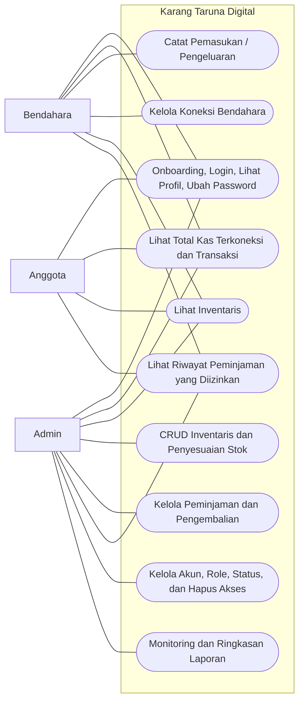

### 1.2 Use case Koneksi Bendahara

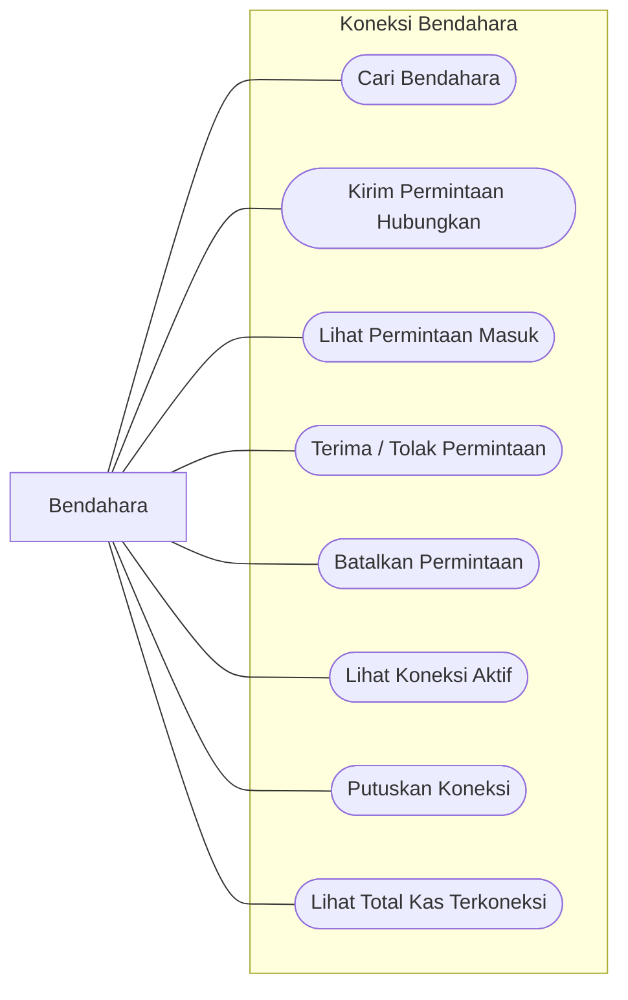

### 1.3 Use case Inventaris dan Pengguna Admin

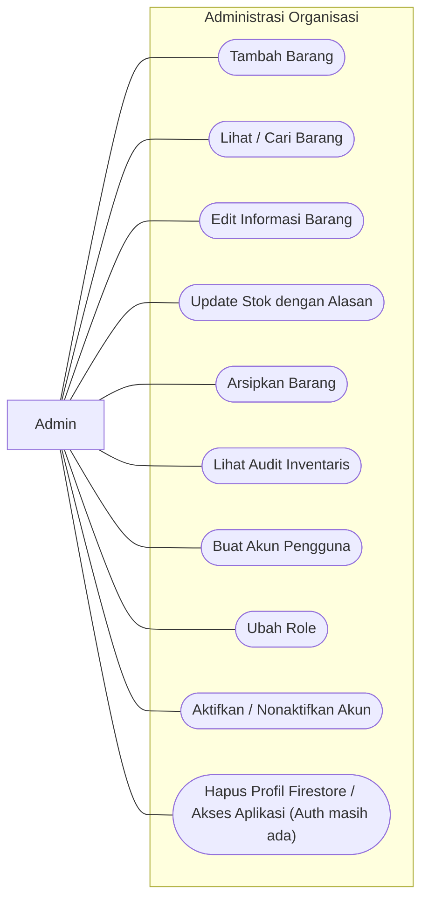

## 2. Activity Diagram

### 2.1 Onboarding, login, dan pengalihan berdasarkan role

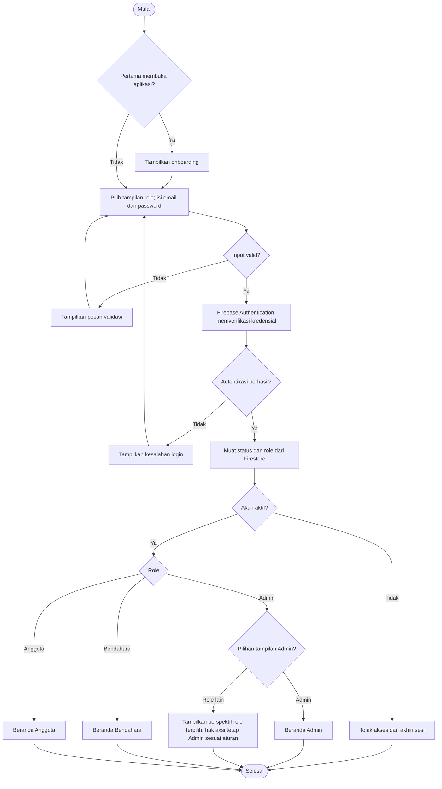

### 2.2 Pencatatan keuangan Bendahara

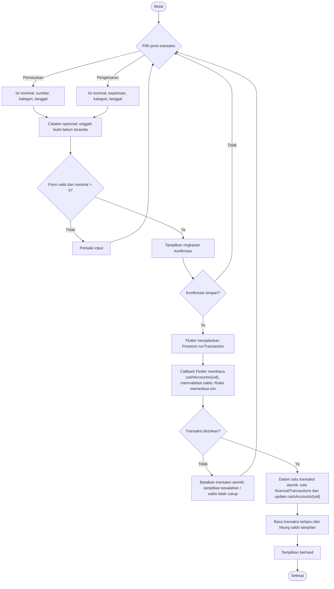

### 2.3 Koneksi antar-Bendahara

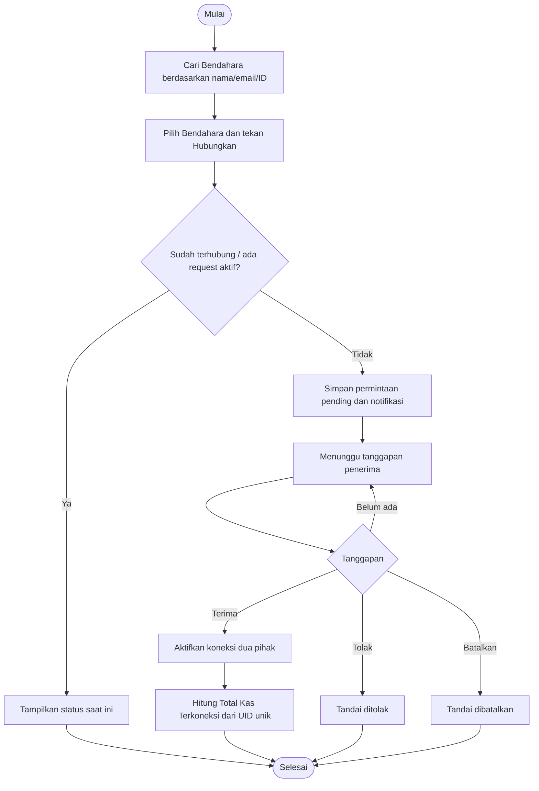

### 2.4 Pengelolaan inventaris Admin

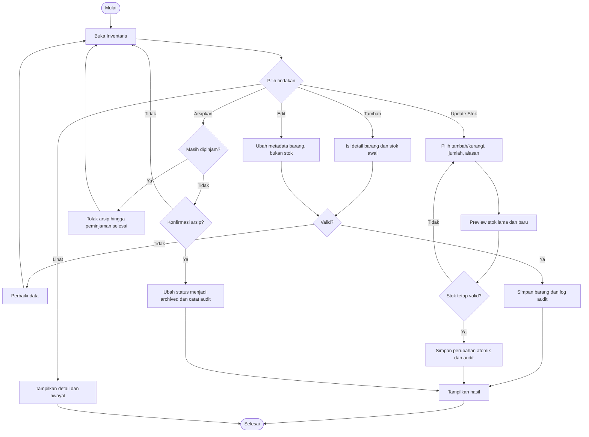

### 2.5 Peminjaman dan pengembalian

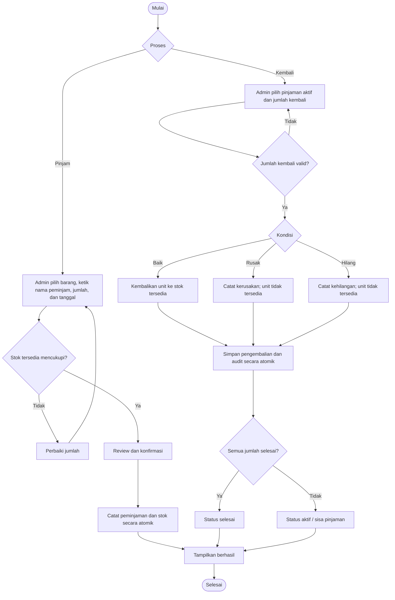

## 3. Sequence Diagram

> **Status:** diagram sequence di bawah menggambarkan **jalur implementasi saat pemeriksaan kode (29 Oktober 2026)**: Flutter ↔ Firebase Authentication / Cloud Firestore, dengan kontrol `firestore.rules`. Cloud Functions/Admin SDK tidak menjadi jalur operasional. Pemakaian `runTransaction` pada keuangan dan penambahan inventaris sudah diidentifikasi dalam pemeriksaan kode; pengujian izin serta kasus bersamaan tetap diperlukan.

### 3.1 Login dan pemuatan role

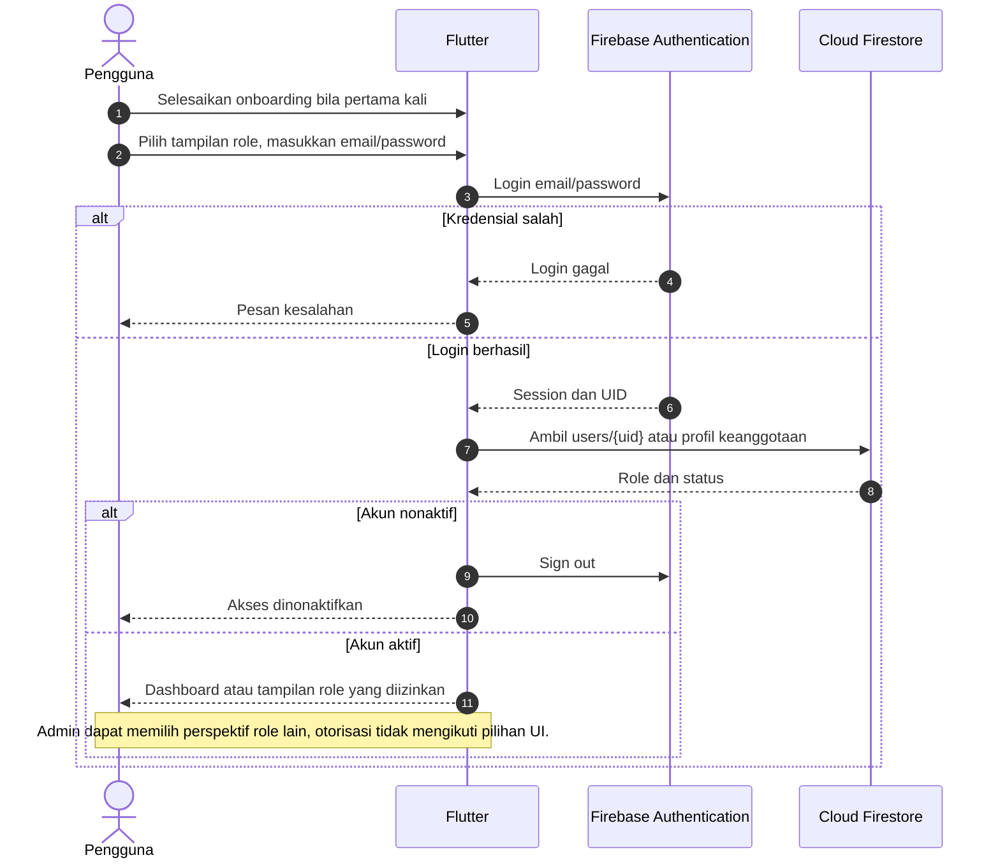

### 3.2 Pemasukan dan pengeluaran — implementasi saat pemeriksaan

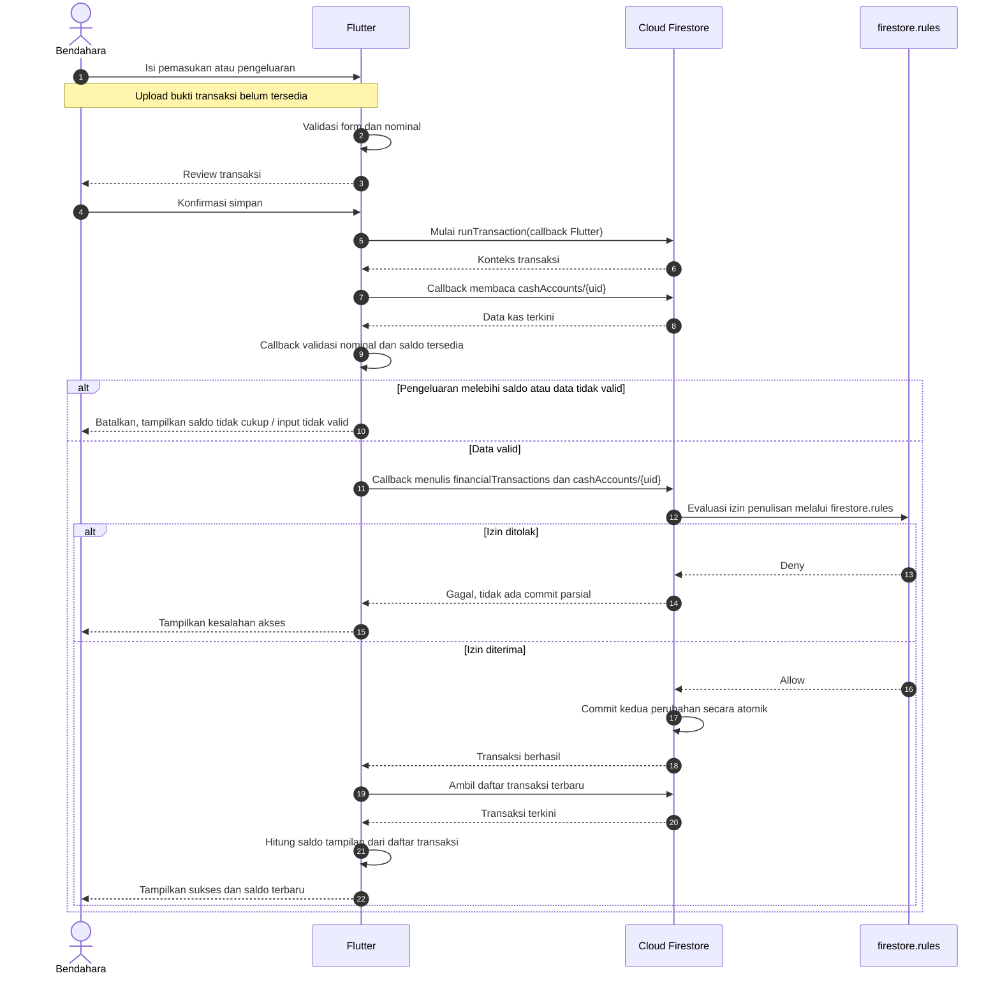

> Callback `runTransaction` di **Flutter** membaca `cashAccounts/{uid}` dan memutuskan apakah saldo mencukupi (berdasarkan pemeriksaan `cloud_stores.dart` sekitar baris 169–183). Firestore memastikan penulisan `financialTransactions` dan pembaruan `cashAccounts/{uid}` di-commit **secara atomik**, sedangkan `firestore.rules` memeriksa izin. Saldo pada UI dihitung dari daftar transaksi. Tidak ada Firebase Storage atau Cloud Functions pada alur ini.

### 3.3 Hubungkan Bendahara — implementasi saat ini

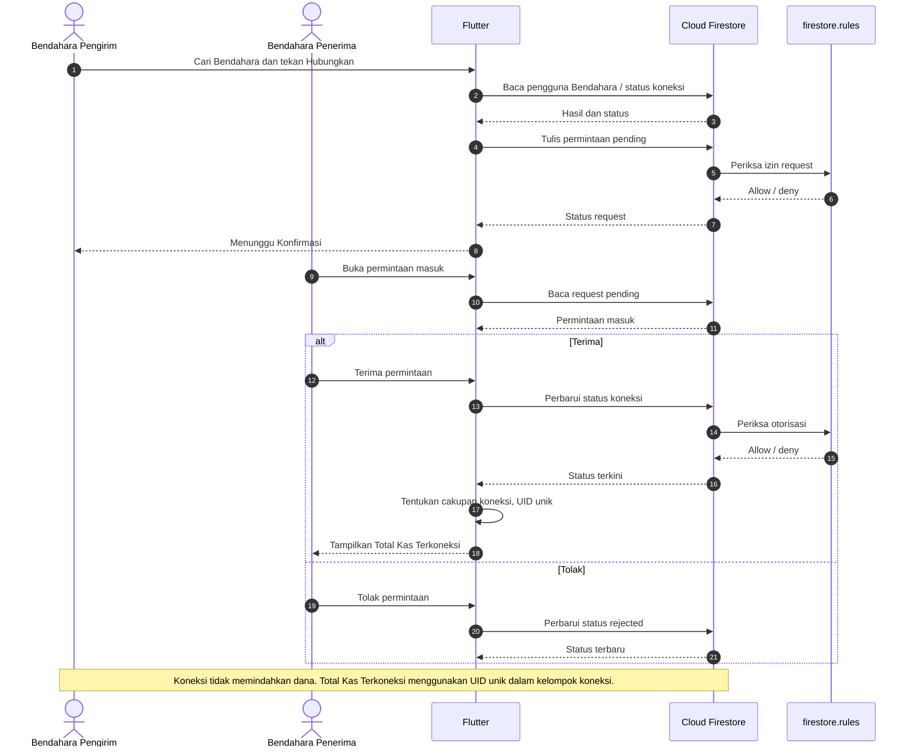

### 3.4 CRUD inventaris dan foto Base64 — implementasi saat pemeriksaan

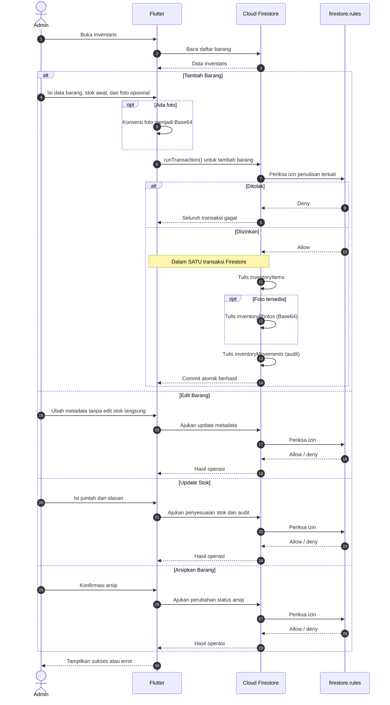

> Saat **menambah barang**, dokumen `inventoryItems`, `inventoryPhotos` (bila ada), dan `inventoryMovements` disimpan dalam **satu transaksi Firestore** menurut `cloud_stores.dart` sekitar baris 422. Foto tetap disimpan sebagai Base64 di Firestore, **bukan Firebase Storage**. Alur Edit/Stok/Arsip ditampilkan ringkas dan tidak otomatis diasumsikan memakai transaksi yang sama.

### 3.5 Peminjaman dan pengembalian — implementasi saat ini

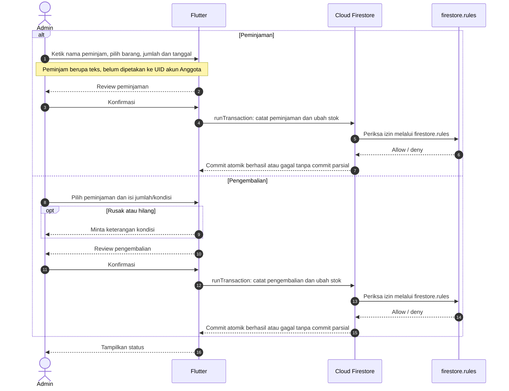

> Peminjaman dan pengembalian menggunakan `runTransaction` untuk menyimpan catatan sekaligus perubahan stok **secara atomik** (berdasarkan pemeriksaan `cloud_stores.dart` sekitar baris 609). Peminjam masih berupa nama teks, **belum terhubung otomatis** dengan UID Anggota yang login.

### 3.6 Admin membuat dan mengelola akun — implementasi saat ini

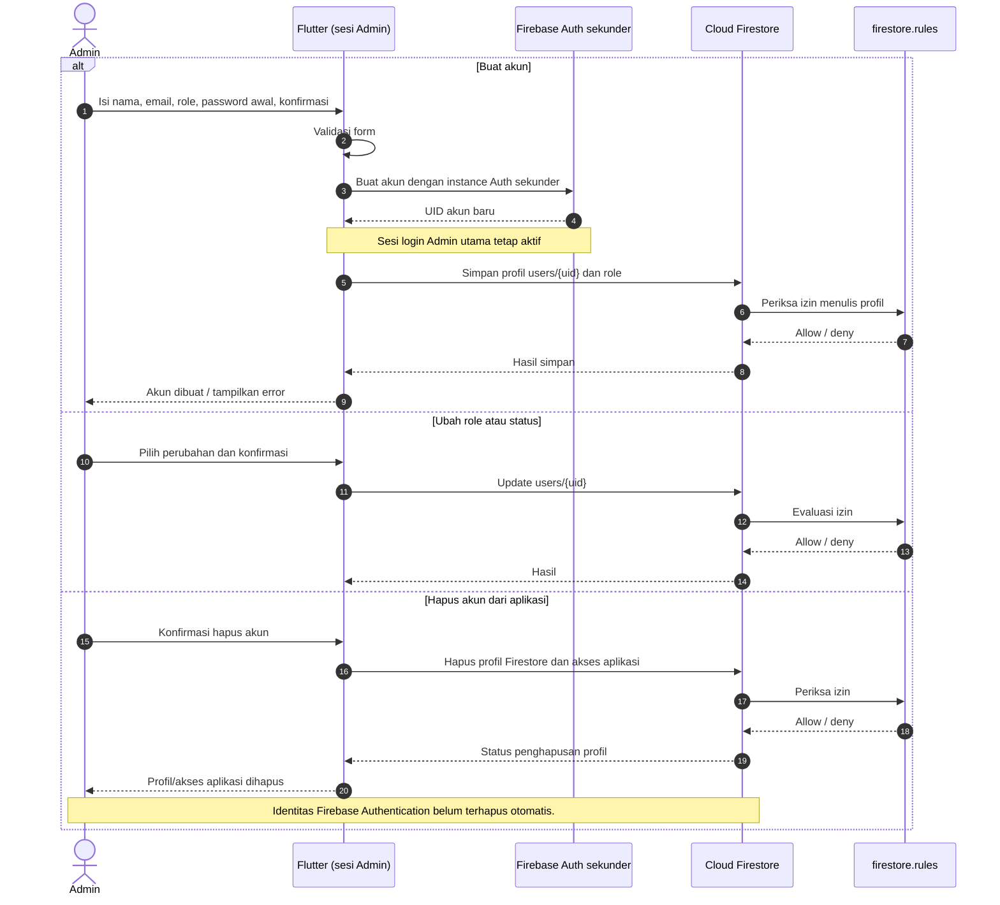

> **Batasan keamanan dan konsistensi:** penghapusan profil Firestore tidak sama dengan penghapusan user Firebase Authentication. Untuk produksi, penegakan role/status pada Rules dan operasi penghapusan perlu diuji; Admin SDK via backend tepercaya merupakan rancangan pengembangan.

### 3.7 Anggota melihat keuangan, inventaris, dan riwayat

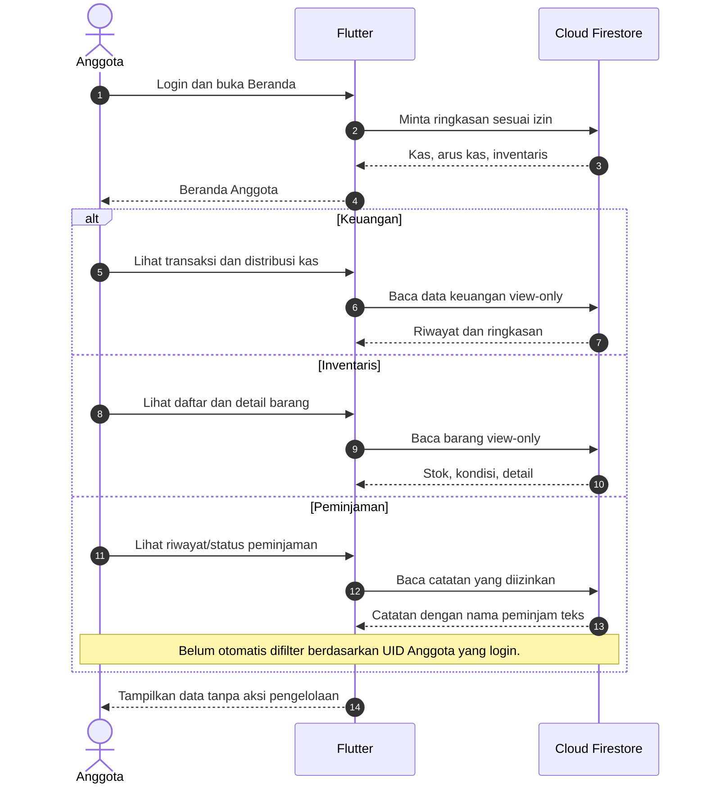

## 4. Ringkasan

| Jenis diagram | Fokus | Jumlah |
|---|---|---:|
| Use Case | Hak akses, koneksi Bendahara, administrasi | 3 |
| Activity | Login, transaksi keuangan, koneksi, inventaris, peminjaman | 5 |
| Sequence | Integrasi Flutter–Firebase pada proses utama | 7 |
| **Total** | | **15** |

**Catatan keamanan dan konsistensi:** Aturan role harus ditegakkan pada Firestore Security Rules, bukan hanya dengan menyembunyikan tombol. Mutasi stok, peminjaman, serta pengeluaran harus diuji terhadap permintaan bersamaan.

## 5. Batasan Implementasi dan Rancangan Pengembangan

| Topik | Implementasi saat ini (berdasarkan catatan kode) | Rancangan pengembangan |
|---|---|---|
| Bukti transaksi | Unggah belum tersedia | Upload file dan penyimpanan aman |
| Foto inventaris | Base64 pada Firestore `inventoryPhotos` | Firebase Storage dengan metadata Firestore |
| Operasi data | Flutter langsung ke Firestore; penulisan keuangan dan tambah barang memakai `runTransaction`, diperiksa `firestore.rules` | Backend tepercaya untuk mutasi sensitif |
| Buat akun | Firebase Auth sekunder + `users/{uid}` | Alur server-side dengan Admin SDK / undangan |
| Hapus akun | Profil Firestore dan akses aplikasi dihapus; identitas Auth belum otomatis terhapus | Penghapusan Auth user yang terotorisasi dan konsisten |
| Total Kas | **Total Kas Terkoneksi** menurut kelompok koneksi UID unik | Optimalisasi agregasi, tanpa mengubah definisinya |
| Peminjam | Nama teks yang dimasukkan Admin | Relasi eksplisit dengan UID pengguna |
| Profil dan password | Melihat profil; ubah password setelah login; reset via email dari login | Perluasan edit profil jika dibutuhkan |
| Laporan | Ringkasan laporan; grafik arus kas ada di halaman Keuangan. Belum ada grafik atau ekspor pada halaman Laporan | Ekspor PDF/CSV bila diimplementasikan |

> **Khusus README:** jangan mempresentasikan kolom rancangan sebagai fitur yang sudah bisa didemokan. Admin **belum memiliki** use case reset password pengguna lain; pengguna dapat mengganti password sendiri setelah login atau meminta reset melalui email pada halaman login.
 **Total Kas Terkoneksi** dihitung dari UID unik dalam kelompok koneksi Bendahara; tidak sama dengan seluruh kas organisasi jika ada Bendahara di luar cakupan koneksi.

## 🚀 Status Pengembangan

**Dalam pengembangan (Work in Progress).**

Proyek dikembangkan secara bertahap, dimulai dari analisis kebutuhan, penyusunan Product Requirements Document (PRD), perancangan UI/UX, hingga implementasi aplikasi menggunakan Flutter dan Firebase.

Fitur yang didokumentasikan merupakan ruang lingkup produk yang direncanakan dan tidak selalu menunjukkan bahwa seluruh fungsi telah selesai diimplementasikan.

### Implementasi saat ini

- Satu formulir **Masuk** dengan Firebase Authentication dan pilihan tampilan Anggota, Bendahara, atau Admin di atas email. Peran dan izin akun tetap diverifikasi dari Firestore; pilihan tampilan tidak dapat menaikkan hak akses akun.

- Proses masuk dan atur ulang password memakai `flutter_bloc`: tindakan formulir menjadi event, hasil Firebase menjadi state, dan tampilan mengikuti state tersebut. Penjelasan kode tersedia di [Alur Login BLoC](docs/ALUR_LOGIN_BLOC.md).

- Bar **Tampilan Admin** di atas halaman utama dihapus. Admin dapat membuka tampilan peran lain melalui **Profil → Ganti Tampilan Peran**; pengelolaan akun tersedia di **Profil → Kelola Pengguna**.

- Pengenalan aplikasi tiga langkah pada pembukaan pertama dengan tombol **Selanjutnya**, **Lewati**, dan **Mulai**. Status selesai disimpan di perangkat.

- Admin dapat membuka tampilan Anggota, Bendahara, dan Admin dari menu ganti tampilan setelah masuk. Empat tab utama adalah Beranda, Inventaris, Keuangan, dan Profil.

- Setelah login Firebase, transaksi, inventaris, peminjaman, pergerakan stok, dan pengguna dibaca dari Firestore dengan filter `organizationId`. Aplikasi yang dijalankan tidak memuat data contoh lokal.

- Form pemasukan/pengeluaran Bendahara menyimpan ke Firestore lewat transaksi atomik. Aturan Firestore menolak saldo negatif dan mengharuskan pembaruan saldo dipasangkan dengan catatan transaksi.

- Admin dapat menambah dan mengubah barang, menyesuaikan stok dengan alasan, mengarsipkan barang, mencatat peminjaman, serta mengembalikan barang dengan kondisi baik/rusak/hilang. Stok siap pinjam hanya bertambah untuk barang yang kembali dalam kondisi baik.

- Admin menyimpan inventaris, foto barang yang diperkecil, peminjaman, dan pengembalian langsung lewat transaksi Firestore. Pada **Tambah Pengguna**, Admin memilih peran serta mengisi password awal dan konfirmasinya. Akun dibuat di Firebase Authentication melalui instance sekunder agar sesi Admin tidak terganti; profil, peran, dan status akun disimpan di Firestore. Password tidak disimpan di Firestore atau ditampilkan di daftar pengguna. Angka **Pengguna** di dashboard menghitung dokumen akun yang dibuat Admin pada organisasi ini, bukan angka contoh.

- Bendahara mengirim, menerima, menolak, membatalkan, dan memutus koneksi melalui Firestore; notifikasi koneksi tersimpan di koleksi `notifications`.

- Grafik arus kas mengikuti transaksi yang dibaca dari Firestore pada bulan berjalan.

- Menu **Data Profil** membaca dokumen akun langsung dari Firestore. Menu **Ubah Password** memverifikasi password saat ini dan memperbaruinya melalui Firebase Authentication.

- **Kelola Pengguna** menyediakan ubah status/peran dan **Hapus Akun**. Hapus Akun menghapus profil Firestore serta akses aplikasi; identitas email Firebase Authentication tetap perlu dihapus terpisah dari **Authentication → Users** jika ingin menghapusnya sepenuhnya atau memakai ulang email. Admin tidak dapat menghapus akun sendiri.

- Konfirmasi tindakan memakai dialog dengan tombol aksi penuh di atas dan **Batal** di bawah; hasil tindakan memakai dialog status yang seragam.

Peta lengkap lokasi koleksi dan field untuk demo tersedia di [docs/PETA_FIELD_FIREBASE.md](docs/PETA_FIELD_FIREBASE.md).

Firebase Core sudah diinisialisasi pada Android memakai `android/app/google-services.json` dan pada web memakai `lib/firebase_options.dart` untuk proyek `karangtaruna-apps`. Provider email/password telah diaktifkan di Firebase Authentication. Login membaca peran, status aktif, dan organisasi dari dokumen Firestore `users/{uid}`. Akun Admin pertama disiapkan oleh pengelola proyek; kredensial dan alamat email akun awal tidak dicantumkan dalam README publik.

Email pengguna baru wajib berakhiran tepat `@gmail.com`. Form tambah pengguna, layanan pembuatan akun, login, pemulihan sesi, dan aturan Firestore menerapkan kebijakan ini. Satu-satunya pengecualian adalah akun Admin pertama yang telah disiapkan, yang tetap harus memiliki peran `admin` pada profilnya. Akun lama dengan domain lain tidak dapat mengakses aplikasi setelah aturan ini diterapkan; Admin perlu membuat akun Gmail pengganti bila diperlukan. Pada paket Spark, aturan Firestore melindungi data aplikasi, tetapi tidak mencegah seseorang memanggil API Firebase Authentication secara langsung untuk membuat identitas tanpa profil aplikasi.

**Status backend:** aplikasi memakai Firebase Authentication dan Firestore pada paket Spark tanpa Cloud Functions. Halaman masuk menyediakan satu aksi **Masuk**; tidak ada pilihan mode lokal. Aturan Firestore memeriksa peran, organisasi, dan beberapa invariant transaksi. Data contoh hanya dipakai oleh tes otomatis. Cloud Storage untuk Firebase memerlukan paket Blaze, sehingga foto inventaris disimpan sebagai JPEG kecil (maksimal 150 KB sebelum Base64) di Firestore. Unggah bukti transaksi belum tersedia.

### Menyiapkan login Firebase

1\. Database Cloud Firestore `(default)` telah dibuat di Jakarta (`asia-southeast2`), provider Email/Password telah diaktifkan, dan aturan `firestore.rules` telah diterapkan pada proyek `karangtaruna-apps`.

2\. Admin pertama sudah dibuat. Masuk memakai kredensial yang telah disiapkan, atau gunakan **Atur / lupa password** untuk mengatur ulang password melalui email. Pengguna baru berikutnya dibuat dari **Kelola Pengguna**.

3\. Aturan Firestore membatasi akses baca dan tulis menurut peran dan organisasi. Terapkan perubahan aturan dengan `firebase deploy --only firestore:rules --project karangtaruna-apps`.

4\. Admin menentukan password awal saat membuat akun dan menyampaikannya kepada pengguna melalui saluran yang aman. Pengguna dapat mengganti password sendiri dari **Profil → Ubah Password** dengan memverifikasi password saat ini; persetujuan Admin tidak diperlukan. Alur **Atur / lupa password** pada halaman masuk tetap tersedia jika pengguna lupa password. Penonaktifan profil mencegah masuk ke aplikasi, tetapi tidak menonaktifkan identitas di Firebase Authentication.

Aturan akses dapat diuji tanpa data nyata dengan JDK 21 atau lebih baru: jalankan `npm ci --prefix firebase-tests`, lalu `npm test --prefix firebase-tests`. Pengujian memakai proyek emulator `demo-karangtaruna` dan mencakup transaksi kas, inventaris, akun, serta koneksi Bendahara.

Jika provider login, profil, atau izin baca belum disiapkan, aplikasi menampilkan pesan kesalahan dan tidak memberi akses. Jangan menaruh password pengguna di berkas proyek.

PRD v2.0 menjadi acuan jika gambar ZIP atau dokumen UI/UX lama berbeda. Aplikasi tidak menyediakan transfer antarbendahara. **Total Kas Terkoneksi** Bendahara menjumlahkan saldo dirinya dan seluruh Bendahara dalam satu komponen koneksi aktif, masing-masing sekali, termasuk rantai A–B–C. Admin dan Anggota melihat gabungan saldo unik semua Bendahara yang memiliki koneksi aktif dalam organisasi. Permintaan `pending` dan koneksi terputus tidak dihitung. Aturan akses detail transaksi antar-role masih perlu diputuskan secara produk sebelum produksi.

Jalankan pratinjau web di alamat tetap `http://127.0.0.1:5080/`: pilih konfigurasi **Flutter Web (localhost:5080)** saat menekan F5 di VS Code, atau jalankan tugas **Flutter Web: port 5080** melalui **Terminal → Run Task** / `run-web.bat`, lalu buka alamat tersebut di Chrome. Skrip memakai perangkat `web-server` agar tetap melayani halaman meski koneksi debugger Chrome terputus. Panel **Mobile Preview** pada workspace ini juga diarahkan ke alamat yang sama. Perintah biasa `flutter run -d chrome` tanpa opsi `--web-port=5080` akan memilih port otomatis. Hentikan sesi sebelumnya dengan Ctrl+C sebelum menjalankan sesi baru pada port yang sama. Untuk perangkat Android, gunakan perintah Flutter sesuai emulator yang tersedia. Periksa kode dengan `flutter analyze` dan `flutter test`. Firebase telah dikonfigurasi pada Android dan Web; iOS memerlukan pendaftaran aplikasi dan konfigurasi tersendiri. Sebelum pemakaian produksi, putuskan akses detail transaksi antarperan dan lakukan pengujian keamanan lanjutan.

Jika menjalankan Flutter langsung dari PowerShell dan `pub.dev` tidak dapat diakses, atur `$env:PUB_HOSTED_URL="https://pub.flutter-io.cn"` pada terminal tersebut sebelum `flutter pub get` atau `flutter run`. Konfigurasi F5 dan `run-web.bat` sudah mengatur mirror ini untuk proses masing-masing.

## 📌 Penutup

Karang Taruna Digital diharapkan dapat menjadi solusi pengelolaan organisasi kepemudaan yang lebih modern, transparan, dan terorganisasi.

Dengan mengintegrasikan manajemen keuangan, inventaris, pengguna, serta peminjaman barang dalam satu aplikasi, pengurus dan anggota Karang Taruna dapat mengakses informasi organisasi dengan lebih mudah dan efisien.
